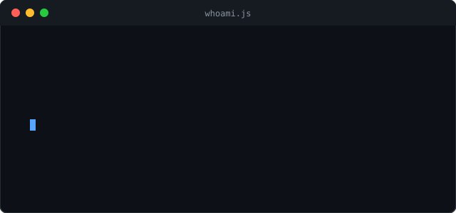
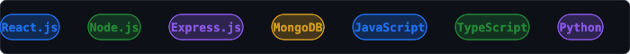

  

  

  

  
  
  

  
  
  
  

  

  

  

👆 a small code editor I built by hand for this profile — watch it type live on GitHub

  

 

## 🚀 About Me

> I'm a final-year BCA student (2023–2026) at ITM SLS Baroda University, based in Surat, India. I turn raw data into clear dashboards and business answers using **SQL, Power BI, Python and Excel**.
>
> I'm looking for an entry-level **Data Analyst / BI Analyst** role or internship. I also freelance on Fiverr as a MERN stack developer, which taught me to deliver on a client's deadline, not just my own.

**Tools:** SQL (MySQL) · Power BI (DAX, Power Query) · Python (Pandas, NumPy, Matplotlib, Seaborn) · Excel · Tableau · Git

 

  

## 📊 Data Analytics Projects

<table>
<tr><th>Project</th><th>What I did</th><th>Stack</th></tr>
<tr>
<td><a href="https://github.com/PalAnghan/Swiggy-Restaurant-Analytics-PowerBI"><b>Swiggy Restaurant Analytics</b></a></td>
<td>Power BI dashboard on ~9,000 restaurants across 9 Indian cities. Compared cities, cuisines, ratings, delivery time and pricing. Found Kolkata has the most restaurants (1,346), Chennai the highest average rating (3.78), and 56.56% of restaurants are mid-range.</td>
<td> </td>
</tr>
<tr>
<td><a href="https://github.com/PalAnghan/Retail-Sales-Analytics-PowerBI"><b>Retail Sales Analytics Dashboard</b></a></td>
<td>Interactive dashboard on 541,909 transactions. Tracks total sales (10.67M), orders (26K), customers (4K) and returns (896.81K), with monthly trends, top 10 countries and products, and customer segments.</td>
<td> </td>
</tr>
<tr>
<td><a href="https://github.com/PalAnghan/Smart_Event_Management_System"><b>Smart Event Management System</b></a></td>
<td>Relational MySQL database for events, venues, organizers, attendees, bookings and payments, with SQL reports using joins, subqueries, window functions and CASE expressions.</td>
<td> </td>
</tr>
<tr>
<td><a href="https://github.com/PalAnghan/Global-Happiness-Analysis"><b>Global Happiness Analysis (2011–2025)</b></a></td>
<td>Analyzed 2,116 records across 13 variables: correlation analysis, trends over time, 2025 country rankings and a focused India analysis.</td>
<td> </td>
</tr>
<tr>
<td><a href="https://github.com/PalAnghan/Retail_Sales_Data_Analyzer"><b>Retail Sales Data Analyzer</b></a></td>
<td>Python tool that loads a CSV, checks for missing or invalid values, reports sales metrics by product and category, exports reports and draws charts.</td>
<td> </td>
</tr>
</table>

  

## 📖 My Journey

<table>
<tr><td width="90"><b>2023</b></td><td>The Start — began BCA with zero coding background, just curiosity.</td></tr>
<tr><td><b>2024</b></td><td>Foundations — learned JavaScript, React, Node.js, Express and MongoDB.</td></tr>
<tr><td><b>2025</b></td><td>Shipping Real Things — built and deployed <b>UrbanNest</b>, a full hostel booking platform, and started freelancing on Fiverr.</td></tr>
<tr><td><b>2026</b></td><td>Data Era — built Power BI dashboards, SQL and Python analysis projects, and completed the Deloitte Australia Data Analytics Job Simulation. Built <b>NutriVision</b> (AI food analyzer) and enrolled in an AI/ML developer program.</td></tr>
<tr><td><b>Now</b></td><td>Final year of BCA, actively looking for an entry-level data analyst role or internship.</td></tr>
</table>

  

## 🤖 Currently Learning — AI / Machine Learning

  

> Enrolled in a full AI/ML developer institute program (~16–18 months), studying in parallel while applying for data analysis internships.

  

## 💻 Web Development Projects

<table>
<tr><th>Project</th><th>Description</th><th>Stack</th></tr>
<tr>
<td><a href="https://github.com/PalAnghan/Nutrivision-AI-Food-Nutrition-Analyzer"><b>NutriVision</b></a></td>
<td>AI food analyzer — reads food photos with the Gemini Vision API and returns calories, protein, health score and age-based recommendations</td>
<td>  </td>
</tr>
<tr>
<td><a href="https://github.com/PalAnghan/hostel-website"><b>UrbanNest</b></a></td>
<td>Deployed full-stack hostel booking platform — my first project real users could actually open and use</td>
<td>   </td>
</tr>
<tr>
<td><a href="https://github.com/PalAnghan/internship-project-management-portal"><b>Internship & Project Management Portal</b></a></td>
<td>Final-year project — a portal to manage internships and student project workflows</td>
<td>  </td>
</tr>
</table>

<b>Other repos:</b> <code>career-bot</code> · <code>job-tracker-mern</code> · <code>weather-app</code> · <code>Python-Fundamental-Booster-Red-White</code> · <code>Logic-Box-Red-and-White-Python</code> · <code>C-Language</code>

  

## 🎮 Fun Zone

  

  

  

  
  
  

